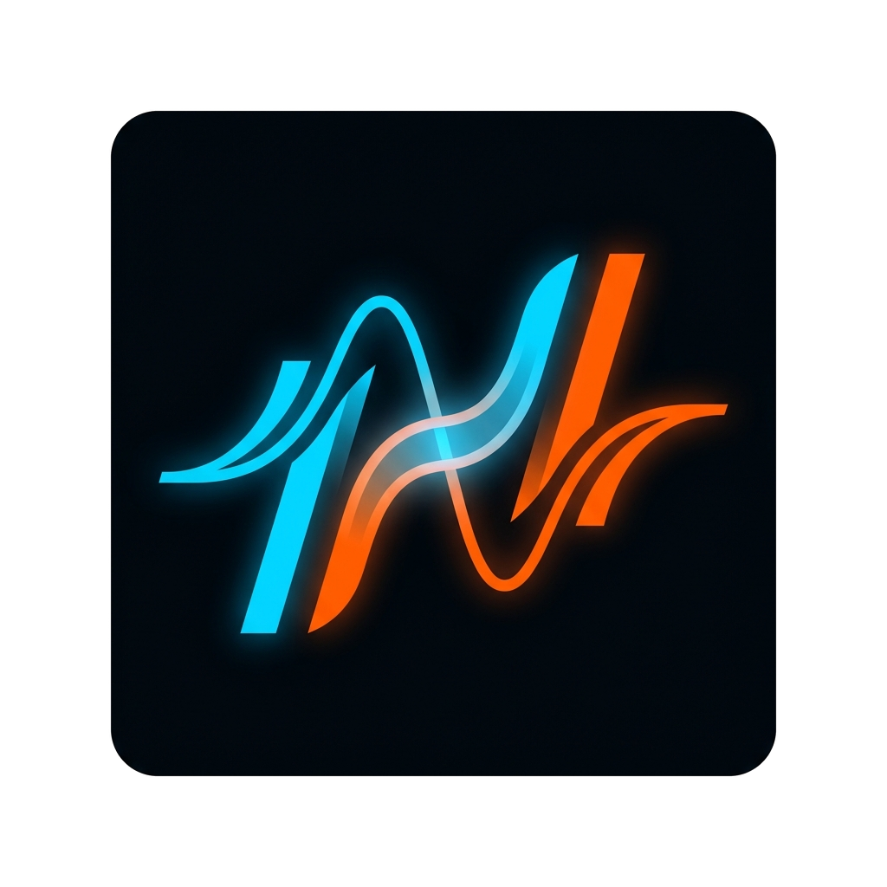

# Harmonic Mix



[⬇️ Télécharger Harmonic Mix pour Windows](https://github.com/Toyoungnem/HarmonicMix/releases/latest/download/HarmonicMix.exe) · [Voir la release](https://github.com/Toyoungnem/HarmonicMix/releases/latest)

## Nouveautés de la version 2.1.0

- Nouveau logo orange et bleu, avec fond extérieur transparent, utilisé dans l'application et dans l'exécutable Windows.
- Interface et classement des suggestions améliorés depuis la version 2.0.0, avec une meilleure prise en compte des transitions, du BPM et de la tonalité.
- Affichage des erreurs et de l'état de recherche simplifié dans le panneau de suggestions.
- Bibliothèque Serato et lecture des métadonnées retravaillées pour une analyse plus fluide.

Assistant local de suggestions de transitions pour Serato DJ Lite ou Traktor. Le classement combine les transitions observées dans les sets, le BPM et la tonalité Camelot. L'application ne capte pas le son et fonctionne hors ligne.

## Démarrer

### Version Windows prête à lancer

[Télécharger HarmonicMix.exe](https://github.com/Toyoungnem/HarmonicMix/releases/latest/download/HarmonicMix.exe), puis double-cliquer sur le fichier téléchargé. Python n'est pas nécessaire. Serato DJ Lite ou Traktor doit être installé séparément, et Harmonic Mix utilise les historiques présents sur l'ordinateur.

### Depuis les sources

Pour lancer le programme avec Python :

```powershell
python -m pip install -r requirements.txt
python app.py
```

Sous Windows, `build_exe.bat` génère une application autonome dans `dist/HarmonicMix.exe`. Python n'est alors pas nécessaire pour l'utiliser. La base locale de l'application est conservée dans `%LOCALAPPDATA%/HarmonicMix`.

## Utilisation

- Sur l'écran d'accueil, choisis **Serato DJ** ou **Traktor** pour les suggestions, ou **Dashboard** pour ouvrir l'analyse plein écran. Le logiciel DJ choisi et le nom du profil restent enregistrés localement.
- Le Dashboard affiche la version de l'application, les sets et morceaux analysés, les transitions fréquentes et une chronologie des genres tagués par set. Les transitions et le BPM moyen du set sont indiqués à côté de chaque période ; les données se mettent à jour automatiquement.
- Les pochettes embarquées dans les fichiers audio s'affichent pour le morceau courant, les suggestions et les transitions du Dashboard. Elles sont lues depuis le disque en arrière-plan ; aucune image n'est téléchargée.
- L'écran d'accueil affiche la piste de référence et permet d'ouvrir le panneau de suggestions.
- Les suggestions rouges, orange et jaunes s'appuient sur les transitions observées ; les bleues sont des propositions harmoniques sans transition connue.
- Une liste de cinq suggestions réserve deux places aux morceaux jamais enchaînés mais compatibles, pour faire tourner la bibliothèque sans écarter les habitudes du set ; un même artiste n'occupe pas plus de deux places.
- Sélectionne une suggestion puis **Chercher dans…** ou double-clique dessus (confirmation demandée) pour lancer la recherche dans le logiciel choisi. Vérifie le résultat puis charge-le manuellement sur le deck.
- Le classement musical suit la roue Camelot (même tonalité, relative majeur/mineur, ±1, ±2, sous-dominante et dominante) et la tolérance demi/double tempo, avec une énergie estimée à partir du BPM. Un morceau sans tonalité ni BPM exploitables ne peut pas être proposé en bleu.
- Les morceaux joués très récemment sont pénalisés pour limiter les répétitions. Une petite tendance de BPM sur les derniers morceaux aide à maintenir une montée ou une baisse progressive du set ; le logiciel n'analyse pas le signal audio.
- Le panneau vérifie les changements d'historique toutes les cinq secondes et reste épinglé au premier plan par défaut.

Les profils sont de simples espaces de données locaux, sans mot de passe, chiffrement ni synchronisation. Ils conviennent pour séparer les bibliothèques sur un même PC, pas pour protéger les données entre utilisateurs du même compte Windows.

## Traktor

- Le lecteur Traktor lit en local `collection.nml` et les playlists `.nml` dans le dossier `History` des dossiers `Documents/Native Instruments/Traktor*` ou `Music/Native Instruments/Traktor*`.
- Traktor enregistre ses playlists d'historique à la fermeture. Harmonic Mix affiche donc la dernière session archivée et apprend les transitions entre les morceaux de ces sessions ; le suivi live Traktor n'est pas pris en charge.
- Le bouton de recherche utilise le champ de recherche du logiciel ouvert. Vérifie le résultat avant de charger une piste.
- La prise en charge a été développée sans installation locale de Traktor : confirme-la avec une bibliothèque et une session `.nml` réelles sur le PC de ton ami.

## Données

- `serato_db.py` lit la base Serato en lecture seule, normalement située dans `%LOCALAPPDATA%/Serato/Library/master.sqlite`.
- `traktor_db.py` lit la collection et les sessions Traktor NML en lecture seule.
- Les fichiers `.session` sont recherchés dans `%USERPROFILE%/Music/_Serato_/History/Sessions`.
- `parser.py` lit les sessions Serato en repli ; `scoring.py` calcule la compatibilité harmonique et rythmique (roue Camelot, tempo, énergie) ; `ui.py` contient l'interface ; `profiles.py` gère les profils locaux.
- Les bases SQLite, les sessions et les fichiers générés (`build/`, `dist/`) sont ignorés par Git pour protéger les données locales.

## Vérifier le classement

```powershell
python -m pytest
python tools/calibration.py
```

`pytest` est installé par `requirements.txt` ; les tests sont aussi jouables sans lui avec `python -m unittest discover -s tests -v`.

Les tests couvrent les règles harmoniques et le classement sans dépendre d'une bibliothèque. `tools/calibration.py` mesure le taux de réussite sur l'historique Serato réel (lecture seule) : 30 % des transitions sont masquées, puis on vérifie si le morceau qui suivait vraiment apparaît dans le top 1, 3 ou 5. Sur une bibliothèque de 5 200 transitions, le classement actuel place la bonne piste dans le top 5 dans ~42 % des cas (et le bon morceau en tête dans ~28 %), contre ~14 % pour l'ancienne pondération (`--legacy`).

## Dépendances

```powershell
python -m pip install -r requirements.txt
```

Les dépendances sont listées dans `requirements.txt`. PyInstaller n'est nécessaire que pour reconstruire l'exécutable avec `build_exe.bat`.
